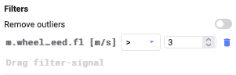

Zu Beginn ist der Scatter-Plot leer.

Zieht Signale per Drag-and-Drop aus der Signal List in die X/Y- oder Color-Signal-Felder, oder doppelklickt sie, um sie dem Plot hinzuzufügen — das funktioniert genauso wie bei einem Time-Series-Plot (siehe [Signal List](/de/deepview/analysis/signal-list#add-signals)).

Nach dem Hinzufügen einiger Signale sieht der Plot etwa so aus:

## Einstellungen

Klickt auf das Einstellungsrad für weitere Konfigurationsmöglichkeiten.

### Eingangssignale resamplen

Ihr könnt das Resampling der Eingangssignale ein- oder ausschalten und die Resampling-Frequenz ändern. Details siehe [Resampling](/de/deepview/analysis/resampling).

### Achsen wechseln

Tauscht die X- und Y-Achse, indem ihr auf den Button **cycle through the signals** klickt.

### Limits der X- und Y-Achse anpassen

Legt die **Limits** der X- und Y-Achse fest.

### Subsampling-Grid anzeigen

Schaltet die Anzeige eines **Subsampling-Grids** ein — nützlich für große Datensätze, da diese entlang eines Grids aggregiert werden.

### Trendlinie

Wendet eine Trendlinie an und wählt, ob sie linear, quadratisch oder kubisch sein soll.

### Filter

- **Remove outliers** — entfernt Datenpunkte, die mehr als 5 Standardabweichungen vom Mittelwert entfernt liegen
- **Filter Signals** — Bedingungen auf Signale setzen, um Daten herauszufiltern; ihr könnt mehrere Filter-Signale hinzufügen

### Color-Signal hinzufügen

Fügt dem Plot eine Farbdimension hinzu, indem ihr ein neues Signal hinzufügt und untere und obere Grenzfarben konfiguriert.

### Eigener Hintergrund

Mit einem eigenen Hintergrund passt ihr die Achsen genau an eure Bedürfnisse an.

- Ladet eine Datei hoch (**Upload**) und richtet die Plot-Ecken aus (**align**), sodass die Daten zum Bild passen
- **Lock plot corner** fixiert die Ecken und blendet den Bereich zum Skalieren aus

{/* Screenshot: Scatter-Plot mit eigenem Hintergrundbild und ausgerichteten Plot-Ecken */}

### Weitere Darstellungsoptionen

- **Bullet size/opacity**
- **Show axes/grid lines/axis labels**
- **Show connecting lines** — zeichnet eine Linie zwischen aufeinanderfolgenden Punkten, um dem Verlauf zu folgen; Linienbreite und Deckkraft sind einstellbar
