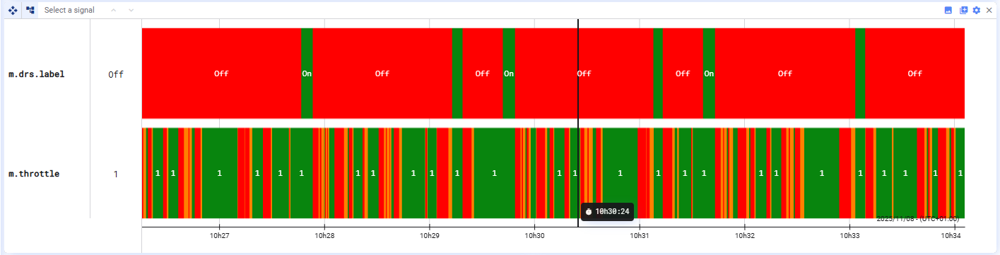
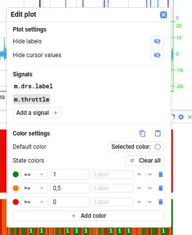

State-Plots zeigen den Zustand eines oder mehrerer Signale über die Zeit, indem sie unterschiedlichen Wertebedingungen Farben zuweisen. Jedes Signal erscheint als horizontaler Balken, dessen Farbe den Zustand des Signals zu jedem Zeitpunkt anzeigt.

### Zustandsfarben definieren

Ihr könnt **Farbregeln** anhand von Bedingungen definieren, etwa:

- Signalwert < X
- Signalwert > X
- Signalwert = X

Jede Regel weist bei Erfüllung ihrer Bedingung eine bestimmte Farbe und ein Label zu.

### Signale hinzufügen

Ihr könnt beliebig viele Signale per Drag-and-Drop zu einem State-Plot hinzufügen. Jedes Signal hat seine eigene Zeile mit eigenen Zustandsregeln.

### Plot-Einstellungen

In den Plot-Einstellungen könnt ihr:

- **Hide labels** — Labels ausblenden
- **Hide cursor values** — Cursor-Werte ausblenden
- Ein Signal auswählen, um dessen **Color settings** zu konfigurieren — sie erscheinen erst, wenn ein Signal hinzugefügt und ausgewählt ist

### Farbregeln

Unter **Color settings** ist jede Zeile in **State colors** eine Regel: Bedingung, Wert, Farbe und ein optionales Label. Die Regeln werden **von oben nach unten** ausgewertet — mit den Pfeilen ändert ihr die Reihenfolge. Der Plot wendet für jeden Zeitbereich die **erste zutreffende Regel** an, und die **Default color**, wo keine zutrifft.

- **Add color** fügt eine Regel hinzu
- **Add all** fügt alle Zustände ein, die aktuell im Plot sichtbar sind
- **Clear all** entfernt alle Regeln

