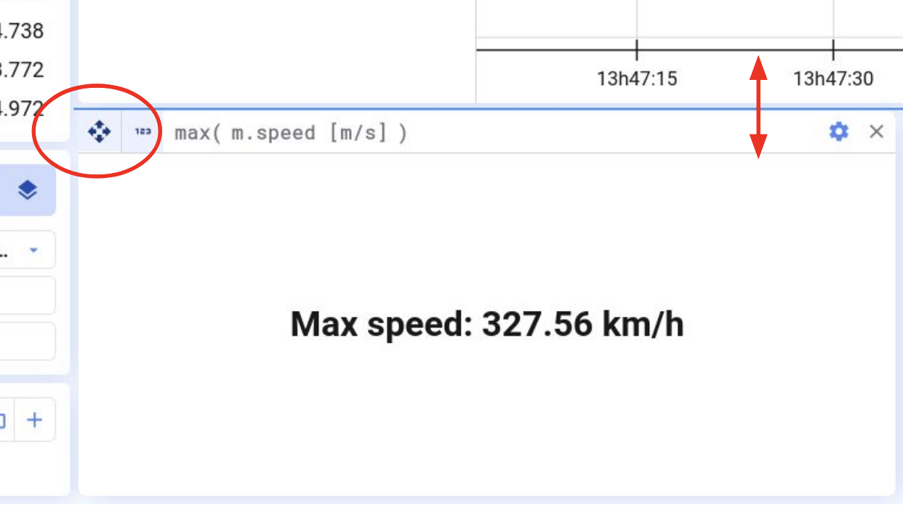
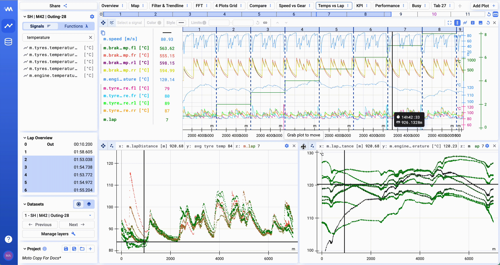
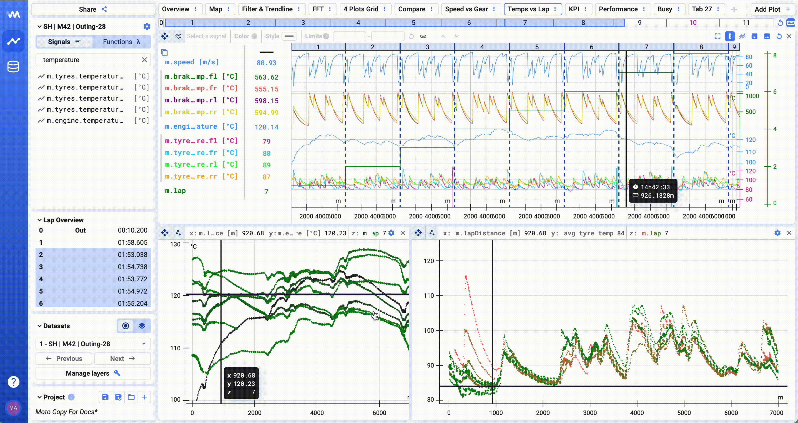

Um Plots neu anzuordnen, greift das Pfeil-Symbol oben links im Plot und zieht ihn an die gewünschte Position.

Hier ein Beispiel, wie ihr eure Plots neu anordnen könnt:

Ihr könnt Plots außerdem breiter oder schmaler machen, indem ihr an ihren Rändern zieht.

## Kopieren, Einfügen und Duplizieren

- **Tabs:** Öffnet das Menü des Tabs (⋮). **Duplicate** kopiert den Tab innerhalb des Projekts; mit **Copy to clipboard** und **Paste from clipboard** bringt ihr ihn in ein anderes Projekt.
- **Plots:** **Duplicate plot** in der Plot-Werkzeugleiste kopiert einen Plot innerhalb des Projekts. Um einen Plot in ein anderes Projekt zu bringen, nutzt die Kopieren-Schaltfläche in der Plot-Werkzeugleiste und danach die Einfügen-Schaltfläche oben im Projekt.

{/* Screenshot: Kopieren-Schaltfläche in der Plot-Werkzeugleiste und Einfügen-Schaltfläche oben rechts im Projekt */}
