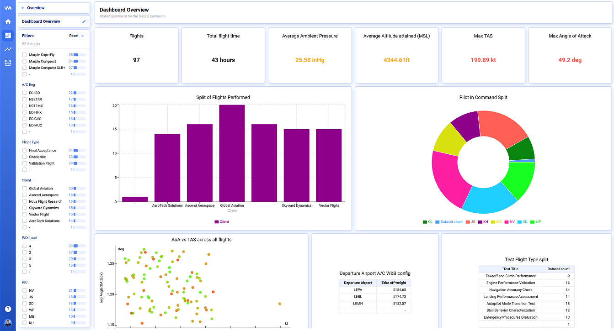
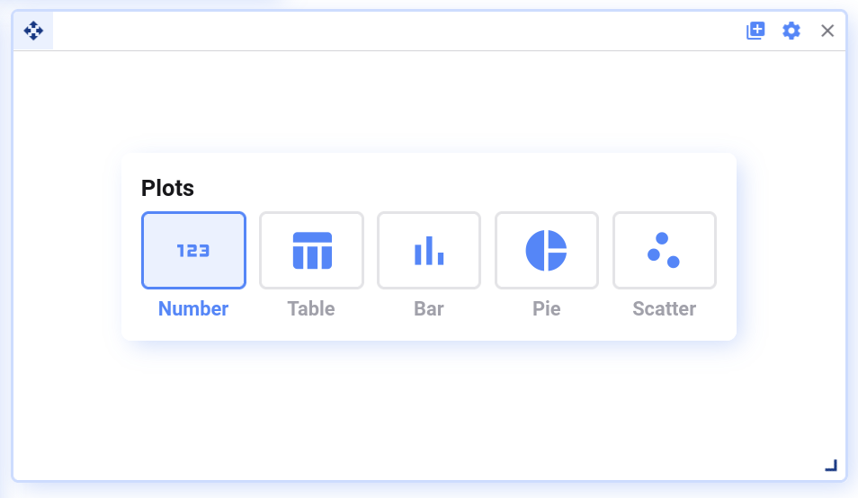
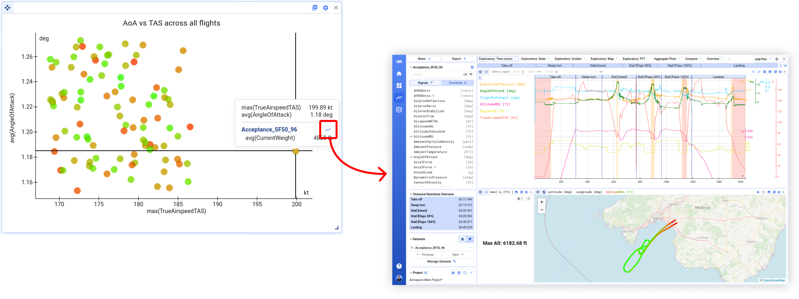
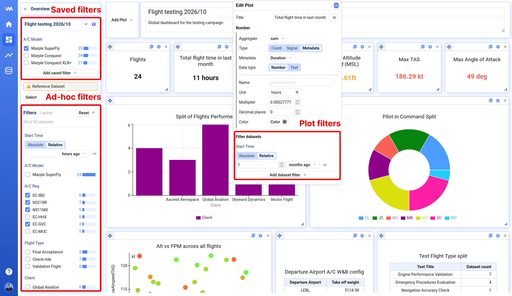
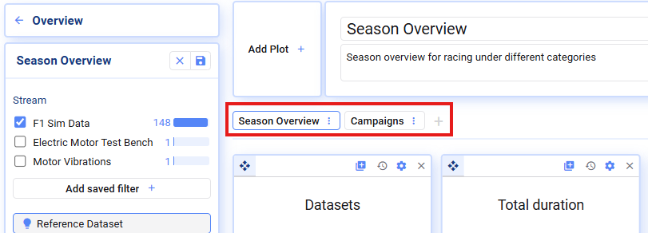

Metrics Dashboards befinden sich in aktiver Weiterentwicklung — Vorschläge und Feedback sind willkommen.

Mit Metrics Dashboards vergleicht ihr alle eure Datensätze in einer einzigen Ansicht. Jeder Plot berechnet eine Kennzahl, etwa ein Maximum, einen Mittelwert oder einen Metadata-Wert, für jeden Datensatz oder für jedes Segment, und stellt die Ergebnisse nebeneinander. Ihr könnt zum Beispiel ein Dashboard bauen, um Maschinen über eine Produktionswoche zu vergleichen oder den Fortschritt einer Testkampagne zu verfolgen:

Öffnet **Metrics** in der linken Navigation, um alle Metrics Dashboards eures Workspace zu sehen. Mit **New metrics dashboard** legt ihr ein neues an.

## Plot-Typen

Aktuell werden folgende Plot-Typen unterstützt:

- **Number Plots** — zeigen einen aggregierten Wert über alle Datensätze, z. B. höchste Motortemperatur über alle Testläufe [°C]
- **Table-, Pie- und Bar-Plots** — zeigen einen oder mehrere Aggregatwerte, gruppiert nach einem zweiten Wert, z. B. maximale Motortemperatur pro Maschine oder die Zahl der Produktionszyklen pro Schicht
- **Scatter Plots** — zeigen zwei Kennzahlen als einzelnen Punkt pro Datensatz oder Segment, z. B. maximale Vibration vs. durchschnittliche Last für jeden Datensatz
- **Trendlines** — verfolgen eine Kennzahl über Datensätze oder Segmente, in der Reihenfolge, die ihr festlegt, z. B. die Zykluszeit jedes Zyklus eines Produktionslaufs, eine Linie pro Maschine

Scatter Plots lassen sich nutzen, um Ausreißer zu identifizieren — klickt auf das Visualize-Icon, um einen Datensatz für eine tiefere Analyse zu öffnen.

Ihr könnt eure Plots auf Basis von Folgendem erstellen:

- Rohsignalwerten aus euren Datensätzen, z. B. `speed`, `temperature`
- Aus Rohsignalen abgeleiteten Math Channels, z. B. `temperature_fahrenheit` — siehe [Functions](/de/deepview/functions)
- Datensatz-Metadata, z. B. `operator`, `location`
- Segment-Metadata, z. B. Dauer oder Index des Segments, wenn der Plot pro Segment berechnet wird — siehe [Datensatz- oder Segment-Ebene](#datensatz--oder-segment-ebene)

Textsignale lassen sich noch nicht als Kennzahl verwenden. Nutzt stattdessen ein numerisches Signal oder ein Metadata-Feld.

### Sortieren und Gruppieren in Bar- und Pie-Plots

- **Sort** — sortiert die Balken oder Ringe nach einem der dargestellten Werte oder nach einem beliebigen Metadata-Feld, auf- oder absteigend
- **Group by** — wählt ein Signal, ein Metadata-Feld oder **None**. Mit **None** bekommt jeder Datensatz bzw. jedes Segment einen eigenen Balken
- **Extra group by levels** — teilt die Balken nach weiteren Metadata-Feldern auf. Jede Ebene zeichnet eine eigene Beschriftungszeile unter der X-Achse

## Datensatz- oder Segment-Ebene

Jeder Plot hat die Einstellung **Granularity**. Sie legt fest, wofür ein Wert im Plot steht:

- **Dataset** — ein Wert pro Datensatz. Das ist der Standard
- **Lap** — ein Wert pro Segment jedes Datensatzes. Ein Produktionslauf mit 120 Zyklen ergibt dann 120 Werte pro Datensatz statt 1

Die Option **Lap** steht nur zur Verfügung, wenn für eure Datenverbindung Segmente eingerichtet sind. Sie trägt den Namen, den euer Workspace für Segmente verwendet, und kann deshalb auch *Stint*, *Run* oder *Segment* statt *Lap* heißen. Derselbe Name steht vor den Segment-Metadata unten.

Wird ein Plot pro Segment berechnet, könnt ihr neben den Datensatz-Metadata auch die Segment-Metadata nutzen:

- **Lap · Duration** — die Dauer des Segments
- **Lap · Index (in dataset)** — die Nummer des Segments innerhalb des Datensatzes
- **Lap · Fastest (in dataset)** — markiert das kürzeste Segment jedes Datensatzes
- **Lap · Label** — der Name des Segments

Signal-Kennzahlen werden nur über das Segment berechnet. *max of Temperature* auf Segment-Ebene ergibt zum Beispiel die Spitzentemperatur jedes einzelnen Zyklus.

**Beispiel: kürzeste Zykluszeit pro Maschine**

1. Fügt einen **Bar**-Plot hinzu und öffnet seine Einstellungen über das Zahnrad-Icon.
2. Setzt **Granularity** auf **Lap**.
3. Setzt für den Balken **Aggregate** auf `min`, **Type** auf **Metadata** und wählt **Lap · Duration**.
4. Wählt unter **Group by** die Option **Metadata** und das Maschinen-Feld.
5. Fügt unter **Filter datasets** das Feld für die Testart hinzu und wählt die Läufe, die ihr vergleichen wollt.
6. Setzt **Sort** auf den Balkenwert, aufsteigend, damit die schnellste Maschine links steht.

{/* Screenshot: Bar-Plot-Einstellungen mit Granularity auf Lap und der minimalen Segmentdauer als Kennzahl */}

Plots auf Segment-Ebene berechnen deutlich mehr Werte als Plots auf Datensatz-Ebene. Kennzahlen auf Segment-Metadata wie der Segmentdauer stehen sofort bereit. Signal-Kennzahlen brauchen Daten für jedes Segment — startet sie deshalb mit **Calculate all** in der Seitenleiste und lasst sie im Hintergrund laufen.

## Trendlines

Eine Trendline verfolgt eine Kennzahl über eure Datensätze oder Segmente. So seht ihr, wie sich ein Wert entwickelt: Zykluszeiten während eines Produktionslaufs, Temperaturen über eine Testkampagne oder die Spitzenlast von Lauf zu Lauf.

Eine Trendline hat folgende Einstellungen:

- **Granularity** — ein Punkt pro Datensatz oder ein Punkt pro Segment
- **Metric** — ein Signal-Aggregat oder ein Metadata-Feld, z. B. *max of Temperature* oder *Lap · Duration*
- **X-axis sort by** — das Metadata-Feld, das die Reihenfolge der Punkte bestimmt, z. B. *Start Time* oder *Lap · Index (in dataset)*. Die Punkte liegen in gleichen Abständen auf der X-Achse
- **X-axis grouping** — ein oder mehrere Metadata-Felder, die aufeinanderfolgende Punkte mit gleichem Wert gruppieren. Jede Ebene fügt eine Beschriftungszeile unter der X-Achse hinzu. Zieht die Ebenen, um ihre Reihenfolge zu ändern; die erste Ebene liegt am nächsten am Plot
- **Split data by** — ein Metadata-Feld, das die Punkte in getrennte Linien aufteilt, eine Farbe pro Wert. Teilt zum Beispiel nach Maschine auf, um eine Linie pro Maschine zu erhalten
- **Y-axis** — lasst die Achse bei null beginnen, passt sie automatisch an die Daten an oder setzt die Grenzen manuell. Manuelle Grenzen helfen, Ausreißer wie Anlaufzyklen auszublenden

**Beispiel: Zykluszeit pro Maschine**

1. Fügt einen **Trendline**-Plot hinzu und öffnet seine Einstellungen.
2. Setzt **Granularity** auf **Lap**.
3. Setzt die Kennzahl auf **Metadata** → **Lap · Duration**. Der Wert wird automatisch als Dauer angezeigt (siehe [Werte formatieren](#werte-formatieren)).
4. Setzt **X-axis sort by** auf **Lap · Index (in dataset)**.
5. Setzt **Split data by** auf das Maschinen-Feld.
6. Wählt unter **Filter datasets** den Produktionslauf und die Maschinen, die ihr vergleichen wollt.

{/* Screenshot: Trendline der Segmentdauern, eine Linie pro Maschine */}

Fahrt mit der Maus über einen Punkt, um alle Datensätze oder Segmente an dieser Position zu sehen. Ein Klick auf das Chart-Icon neben einem Datensatz öffnet ihn zur genaueren Betrachtung in Analysis.

## Werte formatieren

Jede numerische Kennzahl hat die Einstellung **Format**:

- **Number** — eine einfache Zahl mit festgelegter Anzahl Nachkommastellen
- **Duration** — ein Wert in Sekunden, dargestellt als Zeitspanne. Das Standardmuster ist `HH:mm:ss.SSS`
- **Date** — ein Unix-Timestamp in Sekunden, dargestellt als Datum in eurer lokalen Zeit. Das Standardmuster ist `DD/MM/YYYY HH:mm:ss`

Bei **Duration** und **Date** legt das Feld **Pattern** fest, wie der Wert geschrieben wird. Die Muster folgen den [Format-Tokens von moment.js](https://momentjs.com/docs/#/displaying/format/). Einige Beispiele:

| Muster | Beispiel |
| --- | --- |
| `DD/MM/YYYY HH:mm:ss` | 23/05/2025 13:15:02 |
| `ddd D MMM, HH:mm` | Fri 23 May, 13:15 |
| `YYYY-MM-DD` | 2025-05-23 |
| `MMM YYYY` | May 2025 |
| `m:ss.SSS` | 1:14.846 |

Metadata wie *Start Time*, *End Time*, *Duration* und *Lap · Duration* bekommen beim Auswählen automatisch das passende Format. Bei anderen Metadata stellt ihr den **Data type** auf **Number** und wählt das Format selbst. Der **Multiplier** wird vor dem Formatieren angewendet — mit einem Multiplier von `0.001` rechnet ihr also Millisekunden in Sekunden um.

### Gruppieren nach formatierten Werten

Gruppiert ihr einen Table-, Bar- oder Pie-Plot nach einem Datum oder einer Dauer, werden die Datensätze nach dem formatierten Wert gruppiert. Das Muster bestimmt also, wie grob die Gruppen sind:

- `YYYY-MM-DD` ergibt eine Gruppe pro Tag
- `YYYY-[W]WW` ergibt eine Gruppe pro Woche
- `MMM YYYY` ergibt eine Gruppe pro Monat

{/* Screenshot: Format-Einstellungen einer Kennzahl mit Date und eigenem Muster */}

## Filtering

Metrics Dashboards erlauben es, die anzuzeigenden Datensätze auf drei Ebenen zu filtern:

1. **Saved Filters** — trefft eine primäre Auswahl, welche Datensätze im Dashboard erscheinen sollen
2. **Ad-hoc Filters** — nützlich, um schnell in eine Teilmenge der Daten einzutauchen; werden zurückgesetzt, sobald ihr das Dashboard neu öffnet
3. **Plot Filters** — zusätzliche Filterung auf Plot-Ebene; werden ebenfalls als Teil der Dashboard-Definition gespeichert

## Reference dataset

Im Edit-Modus bestimmt das **Reference dataset** in der Seitenleiste, welche Signale ihr in den Plot-Einstellungen auswählen könnt. Wählt einen Datensatz, der alle benötigten Signale enthält. Das Reference dataset ändert nicht, welche Datensätze im Dashboard angezeigt werden.

## Werte berechnen

Kennzahlen werden im Hintergrund berechnet und zwischengespeichert, damit das Dashboard beim nächsten Mal schnell öffnet. Die Seitenleiste zeigt, wie viele Werte bereits berechnet sind.

- **Calculate all** — berechnet jeden Wert im aktuellen Tab, auch für Plots, zu denen ihr noch nicht gescrollt habt
- **Clear failed** — verwirft Werte, deren Berechnung fehlgeschlagen ist, damit sie neu berechnet werden
- **Clear all** — verwirft alle zwischengespeicherten Werte im aktuellen Tab, etwa nachdem ihr einen Math Channel geändert habt

## Tabs

Verteilt eure Plots über mehrere Tabs für einen besseren Überblick.

Im Edit-Modus könnt ihr Tabs hinzufügen, löschen, umbenennen und duplizieren.

