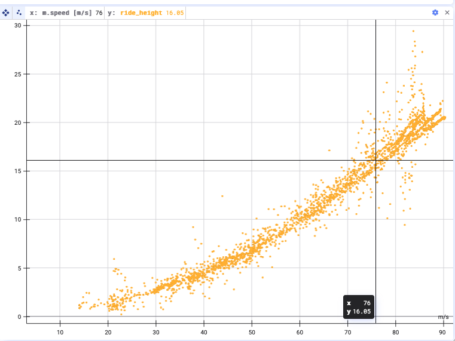
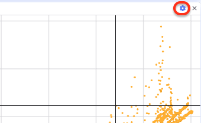
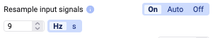
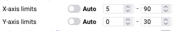
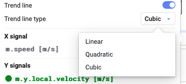
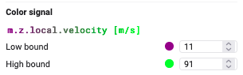

Initially, the scatter plot is empty.

Drag and drop or double-click signals from the signal list into the x/y or color signal fields to add them to the plot — this works the same way as with a Time Series plot (see [Signal List](/deepview/analysis/signal-list#add-signals)).

After adding some signals, the plot looks something like this:

## Settings

Click the settings wheel for further configuration options.

### Resample input signals

You can turn resampling of the input signals on or off, and change the resampling frequency. See [Resampling](/deepview/analysis/resampling) for more details.

### Change axes

Exchange the X and Y axes by clicking the **cycle through the signals** button.

### Alter the limits of the X and Y axes

Set the **limits** of the X and Y axes.

### Show subsampling grid

Turn on the display of a **subsampling grid** — useful for large datasets, since these are aggregated along a grid.

### Trend line

Apply a trend line, and choose whether you want it to be linear, quadratic, or cubic.

### Filters

- **Remove outliers** — removes data points more than 5 standard deviations away from the mean
- **Filter Signals** — add conditions on signals to filter out data; you can add multiple filter signals

{/* Screenshot: filter options with "Remove outliers" and a filter signal */}

### Add a color signal

Add a color dimension to the plot by adding a new signal and configuring lower and upper bound colors.

### Custom background

With a custom background you can tailor the axes exactly to your needs.

- **Upload** a file and **align** the plot corners so the data fits the image
- **Lock plot corner** to lock and hide the resize area

{/* Screenshot: scatter plot with a custom background image and aligned plot corners */}

### More display options

- **Bullet size/opacity**
- **Show axes/grid lines/axis labels**
- **Show connecting lines** — draw a line between subsequent points to follow the trajectory, with adjustable line width and opacity
