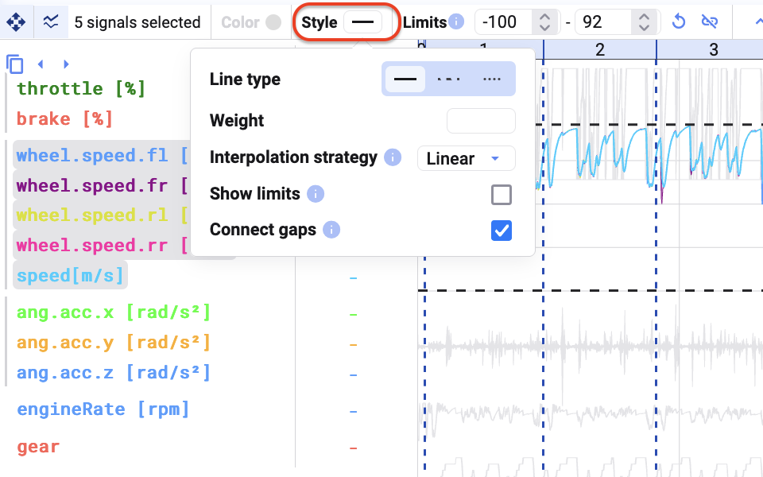
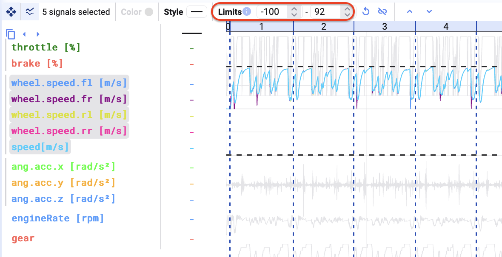
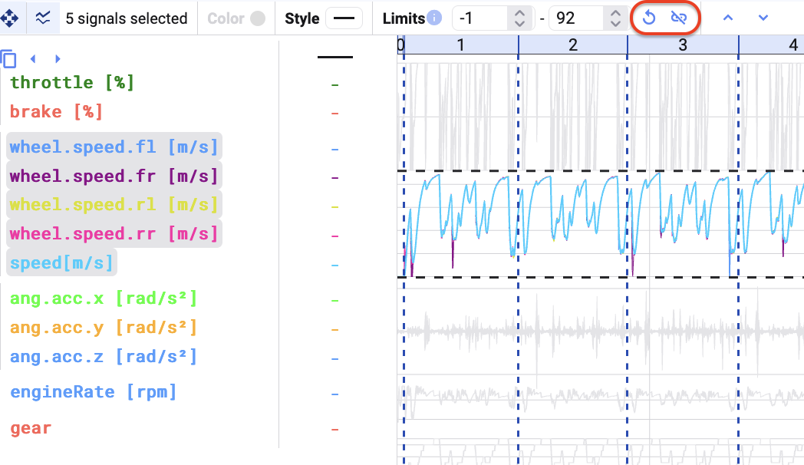
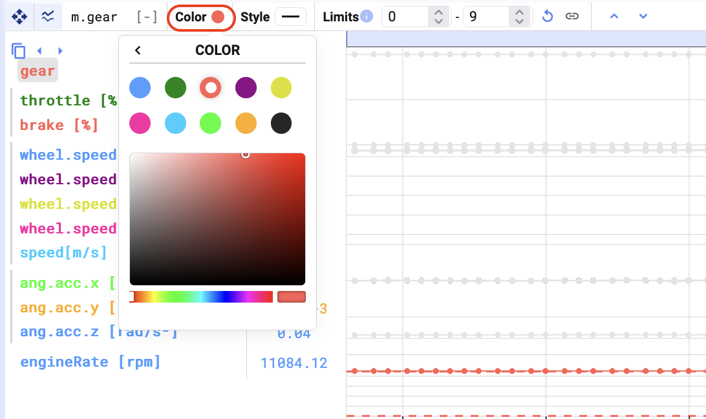
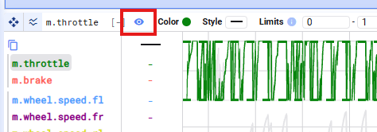

When selecting a signal, or a signal group, you can change how it appears in the plot.

- Change the style of the signals.

- Change the limits of the signals in the group (the minimum and maximum of the y-axis). Changing the limits applies to the entire group.

- Reset the limits for the group, or ungroup the signals.

- When selecting an individual signal, you can also change its color.

- Hide a signal from the plot while keeping it visible in the cursor values table.

