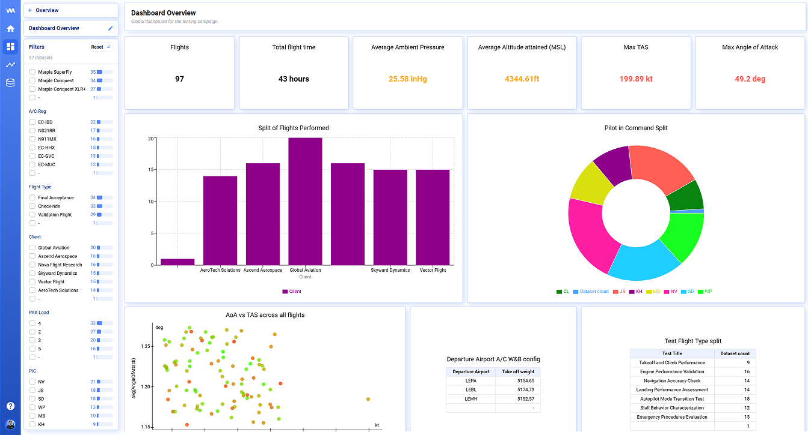
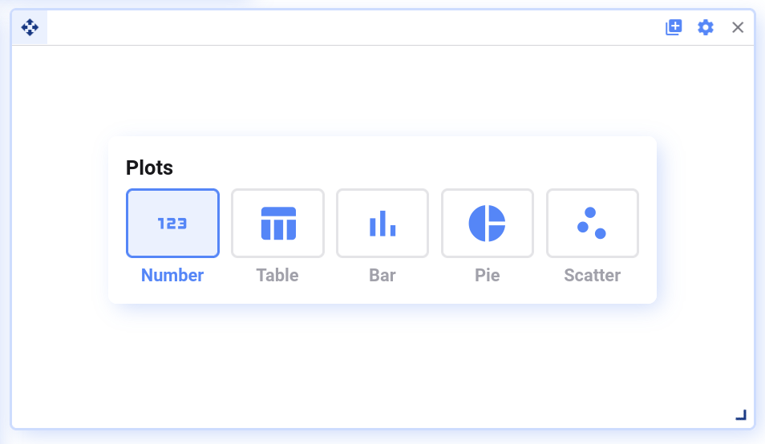
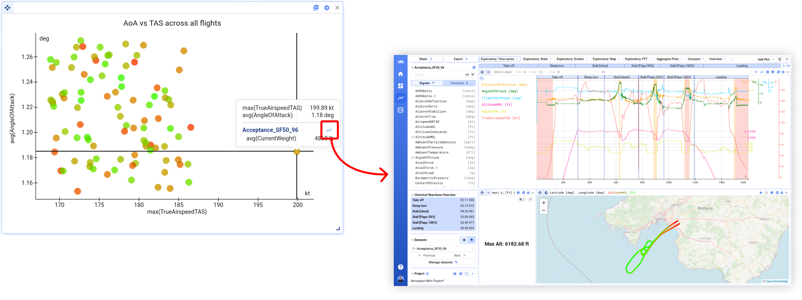
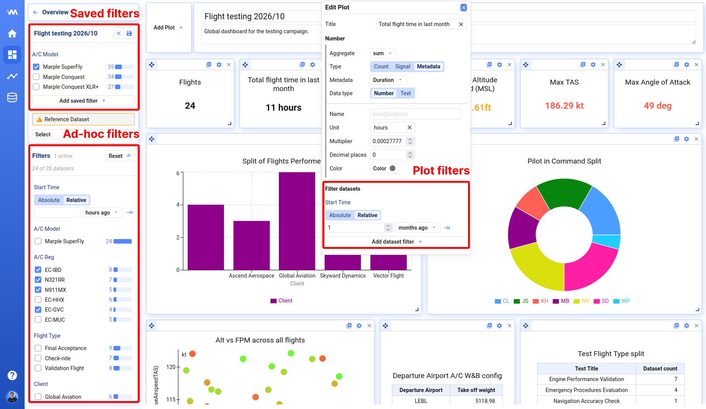
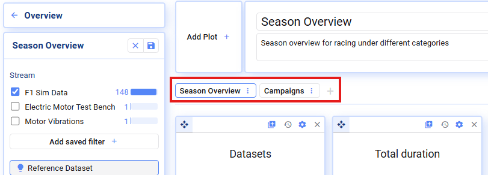

Metrics dashboards are in active development — we welcome your suggestions and feedback.

Metrics dashboards let you compare all your data sets in a single view. Each plot calculates a metric, such as a maximum, an average or a metadata value, for every data set or for every segment, and shows the results side by side. For example, you can build a dashboard to compare machines across a production week or to track the progress of a test campaign:

Open **Metrics** in the left navigation to see all metrics dashboards in your workspace. Click **New metrics dashboard** to create one.

## Plot types

Currently, the following plot types are supported:

- **Number plots** — show one aggregated value across all data sets, e.g. highest motor temperature across all test runs [°C]
- **Table, Pie, and Bar plots** — show one or more aggregated values grouped by a second value, e.g. peak motor temperature per machine, or the number of production cycles per shift
- **Scatter plots** — show two metrics as a single dot for every data set or segment, e.g. maximum vibration vs. average load for every data set
- **Trendlines** — follow one metric across data sets or segments, in the order you choose, e.g. cycle time for every cycle of a production run, one line per machine

Scatter plots can be used to identify outliers — click the visualize icon to open a data set for deeper analysis.

You can build your plots based on:

- Raw signal values from your data sets, e.g. `speed`, `temperature`
- Math channels derived from raw signals, e.g. `temperature_fahrenheit` — see [Functions](/deepview/functions)
- Data set metadata, e.g. `operator`, `location`
- Segment metadata, e.g. segment duration or index, when the plot is calculated per segment — see [Data set or segment level](#data-set-or-segment-level)

Text signals can't be used as a metric yet. Use a numeric signal or a metadata field instead.

### Sorting and grouping in bar and pie plots

- **Sort** — sort the bars or rings on one of the plotted values, or on any metadata field, in ascending or descending order
- **Group by** — choose a signal, a metadata field or **None**. With **None**, every data set or segment gets its own bar
- **Extra group by levels** — split the bars further on more metadata fields. Each level draws its own row of labels under the x-axis

## Data set or segment level

Every plot has a **Granularity** setting. It decides what one value in the plot stands for:

- **Dataset** — one value per data set. This is the default
- **Lap** — one value per segment of each data set. A production run of 120 cycles then gives 120 values per data set instead of 1

The **Lap** option is only available when segments are set up for your data connection. The option takes the name your workspace uses for segments, so it might read *Stint*, *Run* or *Segment* instead of *Lap*. The same name prefixes the segment metadata below.

When a plot is calculated per segment, you can use the segment metadata as well as the data set metadata:

- **Lap · Duration** — the duration of the segment
- **Lap · Index (in dataset)** — the number of the segment within the data set
- **Lap · Fastest (in dataset)** — marks the shortest segment of each data set
- **Lap · Label** — the name of the segment

Signal metrics are calculated over the segment only. For example, *max of Temperature* at segment level gives the peak temperature of every individual cycle.

**Example: shortest cycle time per machine**

1. Add a **Bar** plot and open its settings with the gear icon.
2. Set **Granularity** to **Lap**.
3. For the bar, set **Aggregate** to `min`, **Type** to **Metadata** and pick **Lap · Duration**.
4. Under **Group by**, choose **Metadata** and pick the machine field.
5. Under **Filter datasets**, add the test type field and select the runs you want to compare.
6. Set **Sort** to the bar value, ascending, to put the fastest machine on the left.

{/* Screenshot: bar plot settings with Granularity set to Lap and the metric set to the minimum segment duration */}

Segment-level plots calculate many more values than data-set-level plots. Metrics on segment metadata, such as the segment duration, are instant. Signal metrics need data for every segment, so start them with **Calculate all** in the sidebar and let them run in the background.

## Trendlines

A trendline follows one metric across your data sets or segments. Use it to see how a value evolves: cycle times during a production run, temperatures over a test campaign, or peak load from run to run.

A trendline has the following settings:

- **Granularity** — one point per data set or one point per segment
- **Metric** — a signal aggregate or a metadata field, e.g. *max of Temperature* or *Lap · Duration*
- **X-axis sort by** — the metadata field that sets the order of the points, e.g. *Start Time* or *Lap · Index (in dataset)*. Points are spaced evenly on the x-axis
- **X-axis grouping** — one or more metadata fields that group consecutive points with the same value. Each level adds a row of labels under the x-axis. Drag the levels to change their order; the first level sits closest to the plot
- **Split data by** — a metadata field that splits the points into separate lines, one color per value. For example, split by machine to get one line per machine
- **Y-axis** — start the axis at zero, fit it to the data automatically, or set the limits manually. Manual limits are useful to hide outliers such as warm-up cycles

**Example: cycle time per machine**

1. Add a **Trendline** plot and open its settings.
2. Set **Granularity** to **Lap**.
3. Set the metric to **Metadata** → **Lap · Duration**. The value is shown as a duration automatically (see [Formatting values](#formatting-values)).
4. Set **X-axis sort by** to **Lap · Index (in dataset)**.
5. Set **Split data by** to the machine field.
6. Under **Filter datasets**, select the production run and the machines you want to compare.

{/* Screenshot: trendline of segment durations, one line per machine */}

Hover over a point to see every data set or segment at that position. Click the chart icon next to a data set to open it in Analysis for a deeper look.

## Formatting values

Every numeric metric has a **Format** setting:

- **Number** — a plain number with a set number of decimal places
- **Duration** — a value in seconds, shown as a time span. The default pattern is `HH:mm:ss.SSS`
- **Date** — a Unix timestamp in seconds, shown as a date in your local time. The default pattern is `DD/MM/YYYY HH:mm:ss`

For **Duration** and **Date**, the **Pattern** field sets how the value is written. Patterns follow the [moment.js format tokens](https://momentjs.com/docs/#/displaying/format/). Some examples:

| Pattern | Example |
| --- | --- |
| `DD/MM/YYYY HH:mm:ss` | 23/05/2025 13:15:02 |
| `ddd D MMM, HH:mm` | Fri 23 May, 13:15 |
| `YYYY-MM-DD` | 2025-05-23 |
| `MMM YYYY` | May 2025 |
| `m:ss.SSS` | 1:14.846 |

Metadata like *Start Time*, *End Time*, *Duration* and *Lap · Duration* get the right format automatically when you select them. For other metadata, switch the **Data type** to **Number** and pick the format yourself. The **Multiplier** is applied before formatting, so you can convert milliseconds to seconds with a multiplier of `0.001`.

### Grouping on formatted values

When you group a table, bar or pie plot on a date or duration, data sets are grouped on the formatted value. The pattern therefore decides how coarse the groups are:

- `YYYY-MM-DD` gives one group per day
- `YYYY-[W]WW` gives one group per week
- `MMM YYYY` gives one group per month

{/* Screenshot: format settings of a metric with Date selected and a custom pattern */}

## Filtering

Metrics dashboards let you filter the data sets you want to see, on three levels:

1. **Saved filters** — make a primary selection of which data sets should appear on the dashboard
2. **Ad-hoc filters** — useful to quickly dive into a subset of the data; reset whenever you open the dashboard from scratch
3. **Plot filters** — apply extra filtering at the plot level; also saved as part of the dashboard definition

## Reference dataset

In edit mode, the **Reference dataset** in the sidebar decides which signals you can pick in the plot settings. Choose a data set that contains all the signals you need. The reference dataset doesn't change which data sets are shown on the dashboard.

## Calculating values

Metric values are calculated in the background and cached, so the dashboard opens quickly the next time. The sidebar shows how many values are calculated.

- **Calculate all** — calculate every value in the current tab, also for plots you haven't scrolled to yet
- **Clear failed** — clear values that failed to calculate, so they are calculated again
- **Clear all** — clear all cached values in the current tab, for example after you changed a math channel

## Tabs

Divide your plots across multiple tabs for a better overview.

In edit mode, you can add, delete, rename, and duplicate tabs.

